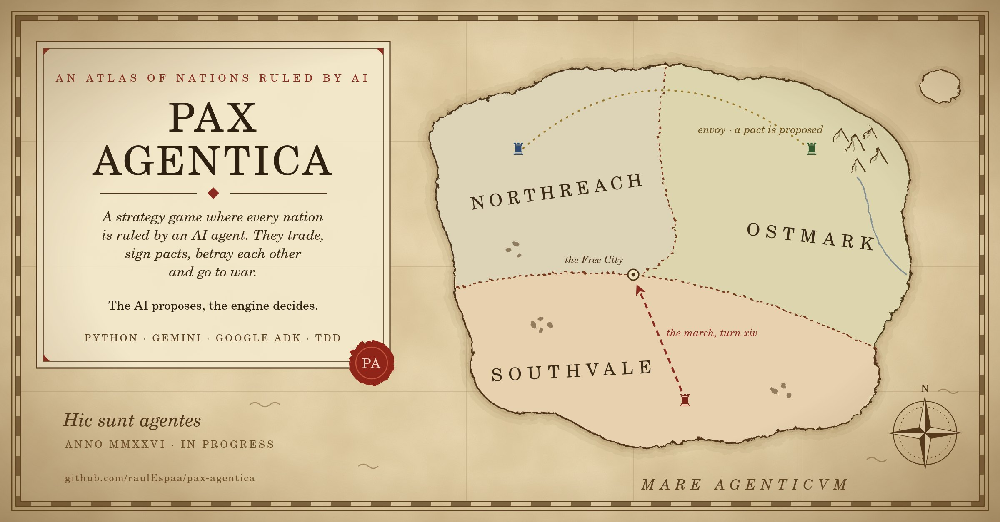
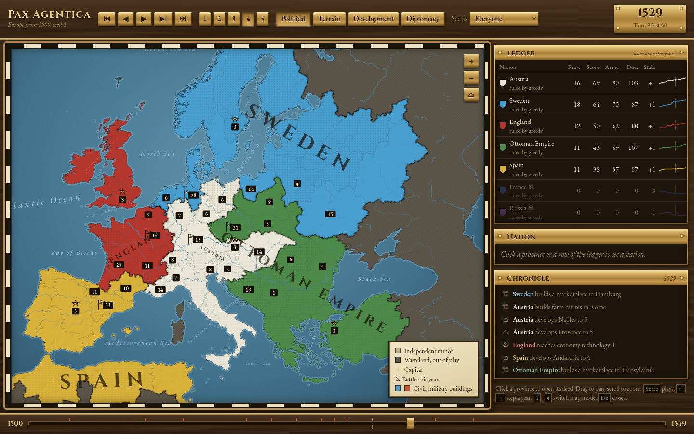
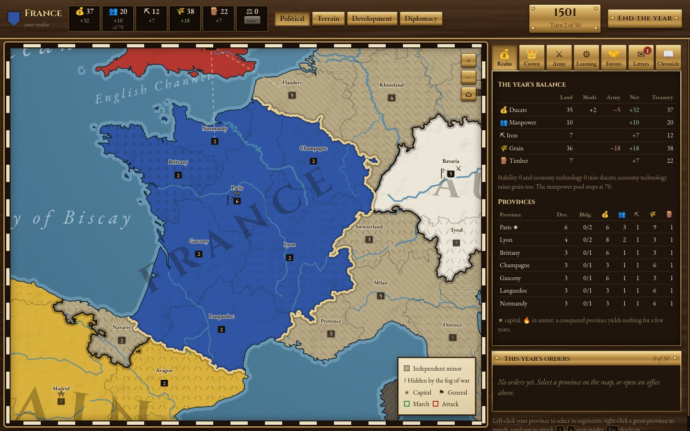

# Pax Agentica

**A strategy game where every nation is ruled by an AI agent.** They produce, trade, sign pacts,
betray each other and go to war. You watch history unfold, and one day you take a throne yourself.

[](https://github.com/raulEspaa/pax-agentica/actions/workflows/ci.yml)


<p align="center"></p>

## The idea

A map of regions. A handful of nations, each governed by an AI with its own personality: the
warmonger, the merchant, the schemer. Every turn they read **only what their nation can see**,
talk to each other in plain language, propose treaties, and choose their moves. Pacts are
promises, not rules: a nation can break one, and the others will remember.

**The AI proposes, the engine decides.** Agents return structured actions; a deterministic game
engine checks that each move is legal and resolves it. No language model ever touches the game
state directly, so a clever (or confused) agent can't cheat its way to victory.

## The game: Europe, 1500

An arcade grand strategy game: **104 provinces** from Lisbon to the Volga, **nine great powers**
(England, France, Spain, the Danubian Austria, the Ottomans, Sweden, Russia, Poland-Lithuania and
Brandenburg-Prussia)
and a scatter of independent minors to swallow. Every province is known for one of fourteen
trade goods, from grain and fish to silver, spices and gold, and can deepen its mines, vineyards
or looms. Six resources (ducats, manpower, iron, grain, timber and goods) feed recruiting,
development, civil and military buildings (some of which consume), manufactories, great works
and stability, with a European market whose prices move with what every court buys and sells. Armies mix pikemen,
archers, cavalry and artillery, each with its ground; sixteen historical monuments, from
Westminster Abbey to Hagia Sophia, reward whoever holds them. A tree of learning unlocks new
buildings and powers; every throne has a historical ruler who ages and dies, and a council of
three advisors; named generals lead the armies.

Every crown has five historical missions (France wants Milan and Naples, Spain the gold of Seville and the Barbary coast, the Ottomans Vienna), and a full treasury can buy glory through patronage or Landsknechte by the regiment. Wars are fought for war score: provinces are occupied, walls besieged, exhaustion mounts, and only a peace moves a border. Prestige, faith and the events of the age (the Reformation, plague, the Fuggers' loans) give every reign its decisions.

Diplomacy is the heart of it, because the other thrones will be AI agents. Courts ally, sign
pacts, trade and send letters; each holds an opinion of every other, raised by gifts and
treaties and wrecked by betrayal. Peace is negotiated: provinces, gold, a yearly tribute or a cap
on the loser's army, with counter-offers and notes going back and forth until both sides sign.
Courts declare friends and rivals in public, proclaim to all Europe, and every ruler has a
character; behind each decision the record keeps the ruler's private reasoning and the counsel of
each advisor, so a replay shows not only what each kingdom did but why.
The full rules are in [`docs/game-rules.md`](docs/game-rules.md).

<p align="center"></p>

The map is real geography: modern administrative regions from
[Natural Earth](https://www.naturalearthdata.com/) (public domain), merged into the game's
provinces, with real rivers and the land outside play shown as wasteland. The replay
is one self-contained HTML file: political, terrain, development and diplomacy map modes, zoom,
a ledger, a chronicle, and a deed for every province with its production and its buildings.

The pictures are of the period too: the rulers' portraits, a town view for every province, and
the scenes of the age (Bruegel's *Triumph of Death* for the plague, Ter Borch's *Treaty of
Münster* for a peace) are paintings and engravings in the public domain from Wikimedia Commons,
fetched and credited by [`scripts/fetch_art.py`](scripts/fetch_art.py) (see the `CREDITS.md`
beside each folder in `src/pax_agentica/web/`).

**You can play it.** `pax serve` puts you on one throne against the others: you see your
nation exactly as an AI ruler does (fog of war included), recruit, build, march, and treat with
the other courts: alliances, pacts, trade, tribute, letters, calls to arms and peace with
reparations.

**With friends, too.** `pax host` serves tables where several people each take a throne in
their browsers and bots hold the rest; a year passes when everyone has ended it, or when the
table's clock runs out. It runs on a laptop for the local network or on Cloud Run with an
invitation code ([`docs/multiplayer.md`](docs/multiplayer.md)); every push to `main` that passes CI
deploys itself ([`docs/deploy.md`](docs/deploy.md)). The AI rulers get the same
view plus a briefing, calculators and a tournament runner ([`docs/agent-tools.md`](docs/agent-tools.md)).

<p align="center"></p>

With nine rule-based "greedy" bots, Spain and France win most games by swallowing the minors
around them, and Austria, squeezed between France and the Turk, is often carved up. Holding them back takes diplomacy, and that's the AI
rulers' job.

## Roadmap

Each milestone ends with something you can run and watch. It's built in order, one at a time.

| # | Milestone | What you see | Status |
|---|-----------|--------------|--------|
| 0 | **Foundations** | A repo with tests, linting, types and CI | ✅ |
| 1 | **The game** | `pax play --seed 1`: Europe 1500, nine rule-based bots, a winner, an HTML replay | ✅ |
| 2 | **The first AI ruler** | One nation is governed by Gemini and plays against the bots | ⏳ next |
| 3 | **Every throne an AI** | Rulers with personalities; the same world plays out differently | |
| 4 | **Diplomacy** | Messages, pacts and trade between nations, and betrayals | |
| 5 | **The chronicler** | An AI historian narrates each game; the replay viewer already exists | |
| 6 | **Memory** | Nations remember who betrayed them | |
| 7 | **Tournaments** | Many seeded games: which personalities win, who keeps their word, what it costs | |
| 8 | **Online** | Deployed, and you can play as one of the nations | |

## How it's built

This is a learning project in **AI engineering**, so the work is split
([ADR 0002](docs/adr/0002-who-writes-what.md)):

- **The game is built by Claude Code**: a pure, deterministic, fully tested engine (`engine/`),
  the baseline bots, the runner, the CLI and the replay viewer. It is the arena, not the lesson.
- **The AI rulers are built by me, by hand**: prompts, structured output, validation, retries,
  frameworks, memory and evaluation. There, Claude Code is a tutor and reviewer, not the author.
  The rules it follows are in [`CLAUDE.md`](CLAUDE.md).
- **Spec first, then tests, then code.** Every feature starts as a one-page spec with testable
  acceptance criteria ([`specs/`](specs/README.md)), then test-driven development: red, green,
  refactor.
- **Decisions are written down** as ADRs ([`docs/adr/`](docs/adr/README.md)), and every finished
  milestone gets a learning note ([`docs/learning/`](docs/learning/README.md)).

## Run it

Requirements: [uv](https://docs.astral.sh/uv/) and GNU make.

```bash
make sync                                  # create .venv from uv.lock (installs Python 3.13 if needed)
make check                                 # lint, types, tests
uv run pax serve --nation france           # rule France yourself, in the browser, against the bots
uv run pax play --seed 1                   # watch nine bots fight over Europe in the terminal
uv run pax play --seed 1 --html replays/1.html   # ... and replay it on a map in the browser
uv run pax view france                     # exactly what France's ruler is allowed to see (JSON)
uv run pax schema                          # the JSON schema a ruler must answer with
uv run pax bench --games 40                # who wins, seat by seat, over 40 seeded games
uv run pax press                           # store capsules and a trailer, drawn from a game of bots
```

## Repository map

| Path | What |
|------|------|
| `src/pax_agentica/engine/` | The rules: map, economy, war, diplomacy, fog of war (pure, no I/O) |
| `src/pax_agentica/players/` | The `Player` protocol and the baseline bots |
| `src/pax_agentica/runner.py`, `cli.py` | The game loop and the `pax` command |
| `src/pax_agentica/server.py`, `web/` | Play a nation in the browser; the shared map code and the replay |
| `src/pax_agentica/data/`, `scripts/build_map.py` | The map of Europe, built from real geography (`make map`) |
| `src/pax_agentica/agents/` | The AI rulers (from milestone 2) |
| `tests/` | Tests, written before the code they test |
| `specs/` | One folder per feature: spec, plan, tasks |
| `docs/game-rules.md` | The rules, for humans and for prompts |
| `docs/vision.md` | What I want to build and learn |
| `docs/adr/`, `docs/learning/` | Decisions and learning notes |
