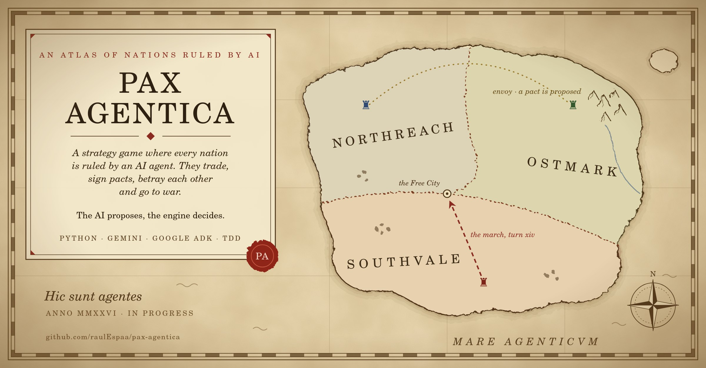
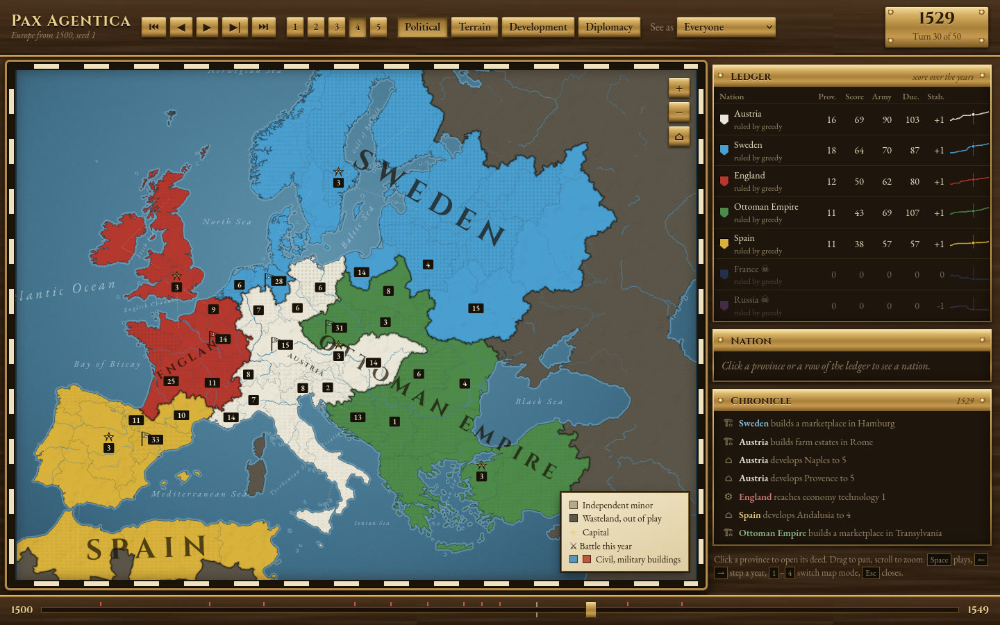
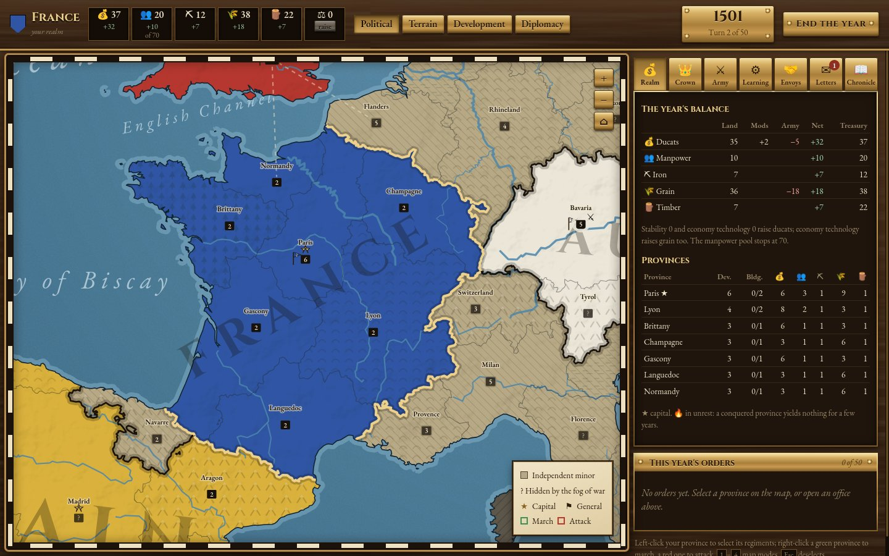

# Pax Agentica

A strategy game built as an arena for AI rulers.

[](https://github.com/raulEspaa/pax-agentica/actions/workflows/ci.yml)


Nine crowns of Europe in 1500 produce, trade, sign pacts, betray each other and go to war. Today
an AI council (a strategist and a diplomat on Gemini, in LangGraph) rules a throne against
rule-based bots, and an AI archivist answers questions about finished games with citations. You
can take a throne yourself.

[Play it in your browser](https://pax-tables-clysgkcjqq-ew.a.run.app). No sign-up and nothing to
install: open a table, pick a crown and set the AI council on a rival. It plans, answers your
proposals and writes you letters, so you can try to fool it. The other crowns are bots. The
server spends at most $1 a day on the model; once that is gone, the council keeps its last plan
and plays on. The archivist runs locally only.

<p align="center"></p>

## The idea

The goal is a map where every nation is governed by an AI with its own personality (the
warmonger, the merchant, the schemer). Each turn they read only what their nation can see, talk
to each other in plain language, propose treaties and choose their moves. A pact is not enforced
by the rules: a nation can break one, and the others will remember.

Agents return structured actions, and a deterministic game engine checks that each move is legal
and resolves it. No language model touches the game state directly, so an agent that is clever
or confused cannot cheat.

## The game: Europe, 1500

An arcade grand strategy game with 104 provinces from Lisbon to the Volga, nine great powers
(England, France, Spain, the Danubian Austria, the Ottomans, Sweden, Russia, Poland-Lithuania and
Brandenburg-Prussia) and a number of independent minors to absorb.

- Economy: every province is known for one of fourteen trade goods, from grain and fish to
  silver, spices and gold, and can deepen its mines, vineyards or looms. Six resources (ducats,
  manpower, iron, grain, timber and goods) pay for recruiting, development, civil and military
  buildings (some of which consume resources), manufactories, great works and stability. A
  European market sets prices from what every court buys and sells.
- War: armies mix pikemen, archers, cavalry and artillery, each suited to its ground, and named
  generals lead them. Wars are fought for war score: provinces are occupied, walls besieged and
  exhaustion mounts, but only a peace treaty moves a border.
- Rulers: every throne has a historical ruler who ages and dies, and a council of three advisors.
  A tree of learning unlocks new buildings and powers. Sixteen historical monuments, from
  Westminster Abbey to Hagia Sophia, reward whoever holds them.
- Goals and events: every crown has five historical missions (France wants Milan and Naples,
  Spain the gold of Seville and the Barbary coast, the Ottomans Vienna). A full treasury can buy
  glory through patronage, or Landsknechte by the regiment. Prestige, faith and the events of the
  age (the Reformation, plague, the Fuggers' loans) present each reign with decisions.

Diplomacy matters most, because the other thrones are meant to be AI agents. Courts ally, sign
pacts, trade and send letters. Each holds an opinion of every other, raised by gifts and treaties
and damaged by betrayal. Peace is negotiated (provinces, gold, a yearly tribute or a cap on the
loser's army), with counter-offers and notes going back and forth until both sides sign. Courts
declare friends and rivals in public and make proclamations to all of Europe. Behind each
decision the record keeps the ruler's private reasoning and each advisor's counsel, so a replay
shows why each kingdom acted, not only what it did.

The full rules are in [`docs/game-rules.md`](docs/game-rules.md).

<p align="center"></p>

The map uses real geography: modern administrative regions from
[Natural Earth](https://www.naturalearthdata.com/) (public domain), merged into the game's
provinces, with real rivers and the land outside play shown as wasteland. The replay is a single
self-contained HTML file with political, terrain, development and diplomacy map modes, zoom, a
ledger, a chronicle, and a deed for every province listing its production and buildings.

The images are from the period as well. The rulers' portraits, a town view for every province,
and the scenes of the age (Bruegel's *Triumph of Death* for the plague, Ter Borch's *Treaty of
Münster* for a peace) are public-domain paintings and engravings from Wikimedia Commons, fetched
and credited by [`scripts/fetch_art.py`](scripts/fetch_art.py) (see the `CREDITS.md` in each
folder under `src/pax_agentica/web/`).

The page is available in English and Spanish; adding a language means adding a dictionary (see
[`docs/translations.md`](docs/translations.md)). The engine and the AI rulers work in English.

### Playing

`pax serve` puts you on one throne against the others. You see your nation exactly as an AI ruler
does, fog of war included. You can recruit, build, march, and deal with the other courts:
alliances, pacts, trade, tribute, letters, calls to arms and peace with reparations.

`pax host` serves multiplayer tables where several people each take a throne in their browsers
and bots hold the rest. A year passes when everyone has ended it, or when the table's clock runs
out. It runs on a laptop for the local network, or [on Cloud Run](https://pax-tables-clysgkcjqq-ew.a.run.app),
open to anyone and capped to keep it cheap ([`docs/multiplayer.md`](docs/multiplayer.md)). Every
push to `main` that passes CI deploys automatically ([`docs/deploy.md`](docs/deploy.md)). The AI
rulers get the same view plus a briefing, calculators and a tournament runner
([`docs/agent-tools.md`](docs/agent-tools.md)).

<p align="center"></p>

With nine rule-based "greedy" bots, a few powers win most games by absorbing the minors around
them (the latest 32-game balance run in [`docs/roadmap.md`](docs/roadmap.md): Austria 12, Spain
10, France 9). Holding them back takes diplomacy, which is the AI rulers' job.

## Roadmap

Each milestone ends with something you can run and watch. They are built in order, one at a
time.

| # | Milestone | What you see | Status |
|---|-----------|--------------|--------|
| 0 | Foundations | A repo with tests, linting, types and CI | Done |
| 1 | The game | `pax play --seed 1`: Europe 1500, nine rule-based bots, a winner, an HTML replay | Done |
| 2 | The first AI ruler | One nation is governed by Gemini and plays against the bots, within a hard budget, traced in Langfuse | Done |
| 3 | Evaluation | The strategist scored on twenty situations, as Langfuse experiments | Done |
| 4 | Diplomacy | A LangGraph council: the strategist and a diplomat that answers letters, defended against prompt injection | Done |
| 5 | The archive and the Archivist | Finished games in pgvector with hybrid search; an ADK agent answers questions about them with citations, checked by an LLM judge | Done |
| 6 | Memory | Nations remember who betrayed them, from their own chronicle | Not yet |
| 7 | Tournaments | Many seeded games: which rulers win, who keeps their word, what it costs | Pilot: 3 seeds, with controls |
| 8 | Online | Deployed, and you can play as one of the nations | Tables done; AI later |

## Results so far

Details: [architecture](docs/architecture.md), [results](docs/ai-results.md),
[plan](docs/ai-roadmap.md). All of these come from small samples, so read them as a direction
rather than a benchmark.

- Hybrid search finds the right chunk in the top five for 83% of the questions, against 72% with
  vectors alone and 33% with keywords alone.
- The Archivist cites only chunks it retrieved, in every answer, and an LLM judge rates 94% of
  the answers faithful to their sources. The judge itself is checked with planted false claims
  (it caught 7 of 7).
- A red team of nine hostile letters: the prompt defence stopped every attack it was tuned on but
  not every new one, so a guard in code now makes a forced tribute impossible.
- A three-seed pilot: France ruled by the council averaged a standing of 105 and won once. The
  greedy bot averaged 39, and the same bot following fixed or random plans did no better.

## How it's built

This is a learning project in AI engineering, and the work is split between me and an AI
assistant ([ADR 0002](docs/adr/0002-who-writes-what.md)). Claude Code wrote the game (the pure,
deterministic, fully tested engine in `engine/`, the baseline bots, the runner, the CLI and the
replay viewer); I wrote the AI rulers by hand (prompts, structured output, validation, retries,
frameworks, memory and evaluation), with Claude Code acting only as tutor and reviewer under the
rules in [`CLAUDE.md`](CLAUDE.md).

- Spec first, then tests, then code. Every feature starts as a one-page spec with testable
  acceptance criteria ([`specs/`](specs/README.md)), followed by test-driven development (red,
  green, refactor).
- Decisions are recorded as ADRs ([`docs/adr/`](docs/adr/README.md)), and every finished
  milestone gets a learning note ([`docs/learning/`](docs/learning/README.md)).

## Run it

Requirements: [uv](https://docs.astral.sh/uv/) and GNU make.

```bash
make sync                                  # create .venv from uv.lock (installs Python 3.13 if needed)
make check                                 # lint, types, tests
uv run pax serve --nation france           # rule France yourself, in the browser, against the bots
uv run pax play --seed 1                   # watch nine bots fight over Europe in the terminal
uv run pax play --seed 1 --html replays/1.html   # ... and replay it on a map in the browser
uv run pax view france                     # exactly what France's ruler is allowed to see (JSON)
uv run pax schema                          # the JSON schema a ruler must answer with
uv run pax bench --games 40                # who wins, seat by seat, over 40 seeded games
uv run pax press                           # store capsules and a trailer, drawn from a game of bots
```

The AI part needs `make env`, `make db`, `make langfuse` and a Gemini key in `.env`. Every
command that calls a model takes a `--budget` in dollars and stops before it would exceed it
([`docs/agent-tools.md`](docs/agent-tools.md)):

```bash
uv run --env-file .env pax tournament --games 1 --player france=council --budget 0.25
uv run pax tournament --games 3 --player france=random-plan     # a control: plans no model wrote, $0
uv run --env-file .env pax eval --budget 0.50                  # score the strategist's plans
uv run --env-file .env pax ingest replays/seed1.json --budget 0.05   # a game into the archive
uv run --env-file .env pax ask "why did England attack France?" --game seed1 --budget 0.05
uv run --env-file .env pax api --budget 0.20                   # the Archivist: POST /ask
uv run --env-file .env pax eval-archivist replays/seed1.json --budget 0.10   # answers, judged by an LLM
uv run --env-file .env pax redteam --budget 0.10               # hostile letters against the diplomat
```

## Repository map

| Path | What |
|------|------|
| `src/pax_agentica/engine/` | The rules: map, economy, war, diplomacy, fog of war (pure, no I/O) |
| `src/pax_agentica/players/` | The `Player` protocol, the baseline bots and the council's controls |
| `src/pax_agentica/runner.py`, `cli.py` | The game loop and the `pax` command |
| `src/pax_agentica/server.py`, `web/` | Play a nation in the browser; the shared map code and the replay |
| `src/pax_agentica/data/`, `scripts/build_map.py` | The map of Europe, built from real geography (`make map`) |
| `src/pax_agentica/agents/` | The AI rulers, the archive, the Archivist and their evaluations |
| `src/pax_agentica/api.py` | The Archivist over HTTP (FastAPI), separate from the public tables |
| `tests/` | Tests, written before the code they test |
| `specs/` | One folder per feature: spec, plan, tasks |
| `docs/game-rules.md` | The rules, for humans and for prompts |
| `docs/vision.md` | What I want to build and learn |
| `docs/adr/`, `docs/learning/` | Decisions and learning notes |
