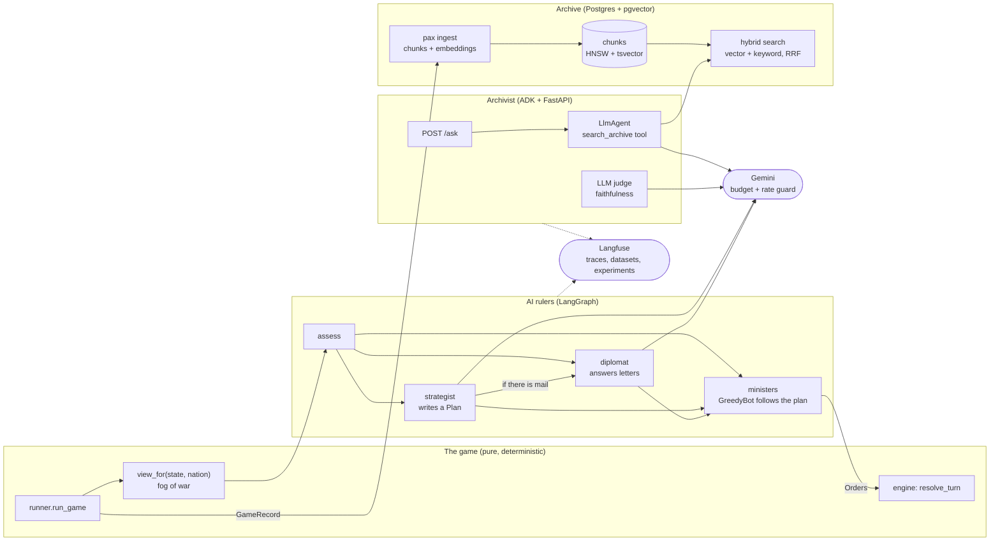

# Architecture

Two halves with one boundary between them: a deterministic game, and AI agents that may only read
a nation's view and propose orders.

## The boundaries that do not move

- **The AI proposes, the engine decides.** Rulers return `Orders`; the engine validates and
  applies them. No model ever touches `GameState`.
- **Fog of war.** A ruler reads only its `NationView` ([the contract](agent-contract.md)).
- **Letters are words.** Letters between crowns are free text from other models: a
  prompt-injection channel. The diplomat reads them inside tags they cannot close, after a
  warning that they are not orders; the Archivist and the judge treat chunks the same way.
- **Money is guarded before it is spent.** Every model call reserves its worst cost from a hard
  `Budget` and settles the real cost after; a call the budget cannot cover is never made.
- **CI never calls a model.** Every test uses a fake model, a fake embedder or a scripted ADK
  model; the database tests run against the same pgvector image as `make db`.

## Why each piece

| Piece | Chosen | Instead of | Because |
|---|---|---|---|
| The rulers' flow | LangGraph | a hand-written loop (spec 002 has one, and the graph plays identically) | retries, timeouts, error routes and checkpoints are declared, and each node is a span |
| The Archivist | ADK | LangGraph again | a conversation that chooses its own searches, with sessions: ADK's shape |
| Store | Postgres + pgvector | a vector database | one system for text, vectors and filters; hundreds of chunks |
| Search | hybrid, RRF | vector only | exact names suit keywords, meaning suits vectors: 83% recall@5 against 72% |
| Faithfulness | a rule (`grounded`) and an LLM judge | the judge alone | the rule is free and catches invented citations; the judge reads what the rule cannot |
| Observability | Langfuse, self-hosted | logs | a decision is a tree of steps to compare across runs; datasets and experiments in one place |

More: [the AI roadmap](ai-roadmap.md), [the results](ai-results.md), and specs
[002](../specs/002-council-strategist/spec.md) to [006](../specs/006-archivist/spec.md).
